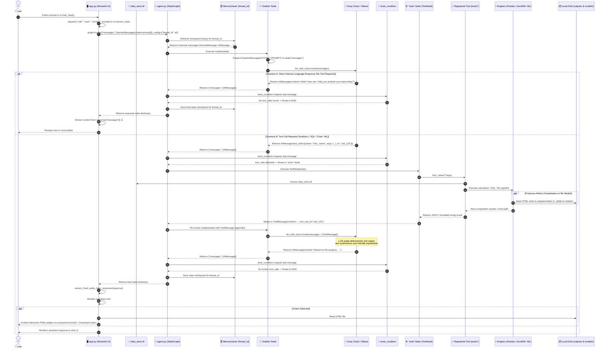

# 🔄 Complete Master Execution Workflow

This document illustrates the end-to-end execution workflow of the **AI Data Analyst**, detailing the exact step-by-step path taken from the initial user request to the final response rendering.

---

## 1. Master Runtime Sequence Diagram (Mermaid)



---

## 2. Step-by-Step Execution Analysis

### Step 1: User Request Ingestion
- The user inputs text via `st.chat_input()` ([app.py#L307](file:///c:/Users/User/Desktop/AI-Data-Analyst/app.py#L307)).
- `app.py` appends the prompt to `st.session_state.messages` to ensure instant UI rendering.

### Step 2: LangGraph Invocation & Checkpoint Retrieval
- `app.py` calls:
  ```python
  config = {"configurable": {"thread_id": st.session_state.thread_id}}
  response = graph.invoke(
      {"messages": [HumanMessage(content=active_input)]},
      config=config
  )
  ```
- LangGraph's `MemorySaver` uses `thread_id` to look up any prior messages from this session.

### Step 3: `chatbot` Node Execution
- Inside `chatbot(state)` ([agent.py#L82-L88](file:///c:/Users/User/Desktop/AI-Data-Analyst/agent.py#L82-L88)), the `SYSTEM_PROMPT` is prepended to the message history.
- The bound model (`llm_with_tools`) is invoked. It checks the prompt against its tool definitions.

### Step 4: Routing Decision via `tools_condition`
- LangGraph evaluates `tools_condition` ([agent.py#L123-L126](file:///c:/Users/User/Desktop/AI-Data-Analyst/agent.py#L123-L126)):
  - **Branch 1 (Direct Answer)**: If the prompt was conversational (*"What tools do you have?"*), the LLM emits plain text without `tool_calls`. Routing proceeds immediately to `END`.
  - **Branch 2 (Tool Invocation)**: If analytical computation is needed, the LLM emits one or more structured `tool_calls` containing the tool name and validated arguments. Routing proceeds to `"tools"`.

### Step 5: `ToolNode` Execution
- `ToolNode` matches the requested tool name against the 18 registered Python functions.
- The Python function executes locally, accessing `data_store.df`, invoking DuckDB, Pandas, or Scikit-Learn.
- If an artifact is produced (e.g., Plotly figure or ML model), it is saved to disk (`outputs/charts/` or `models/`).
- The function returns a structured dictionary or string. `ToolNode` wraps this into a `ToolMessage` carrying the unique `tool_call_id`.

### Step 6: The Cyclic Loop (`tools` $\rightarrow$ `chatbot`)
- The edge `graph_builder.add_edge("tools", "chatbot")` ([agent.py#L127](file:///c:/Users/User/Desktop/AI-Data-Analyst/agent.py#L127)) brings execution back to the `chatbot` node.
- The LLM receives the `ToolMessage` containing the exact mathematical facts.
- The LLM writes a conversational explanation summarizing the findings.

### Step 7: Streamlit Artifact Extraction & Multi-Modal Rendering
- Once the graph reaches `END`, control returns to `app.py`.
- `app.py` invokes `extract_chart_paths_from_response(response)` ([app.py#L142-L172](file:///c:/Users/User/Desktop/AI-Data-Analyst/app.py#L142-L172)).
- It scans all `ToolMessage` payloads for keys named `chart_path`, `charts`, or `feature_importance_chart_path`.
- If an HTML chart file exists on disk, `render_html_chart()` embeds it directly into the chat stream via `streamlit.components.v1.html(html_content, height=500, scrolling=True)` accompanied by an `st.download_button()`.
