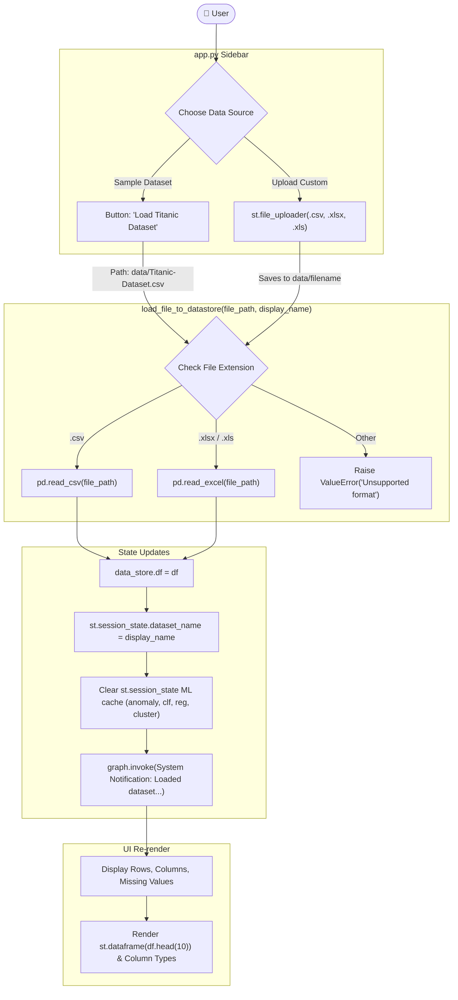
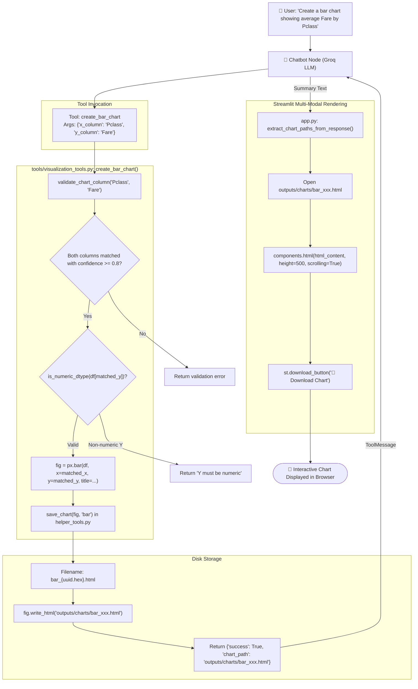

# 🛠️ Individual Tool Workflows

This document details the exact execution paths, data transformations, error handling, and guardrails for the primary data operations: **Dataset Ingestion**, **Descriptive Statistics**, **Columnar SQL Querying**, and **Interactive Visualizations**.

---

## Part A: Dataset Ingestion Workflow

### 1. Workflow Architecture (Mermaid)



### 2. Implementation Mechanics
- **Files Involved**: [app.py#L118-L141](file:///c:/Users/User/Desktop/AI-Data-Analyst/app.py#L118-L141), [tools/dataset_tools.py#L8-L34](file:///c:/Users/User/Desktop/AI-Data-Analyst/tools/dataset_tools.py#L8-L34), [data_store.py](file:///c:/Users/User/Desktop/AI-Data-Analyst/data_store.py).
- **Format Handling**: Extensions are evaluated via `os.path.splitext(file_path)[1].lower()`. CSV uses C-based `pd.read_csv`, and Excel uses `pd.read_excel` (via `openpyxl`).
- **State Clearing**: When a new dataset loads, previous ML studio states (`st.session_state.ml_anomaly_res`, etc.) are reset to `None` to prevent cross-dataset contamination.
- **Agent Notification**: In [app.py#L136-L140](file:///c:/Users/User/Desktop/AI-Data-Analyst/app.py#L136-L140), a system notification message is dispatched into the active `thread_id` so the agent's memory immediately reflects the new row and column count without the user needing to ask.

---

## Part B: Statistical Analysis Workflow

### 1. Workflow Architecture (Mermaid)

```mermaid
flowchart TD
    UserPrompt["👤 User: 'What is the average age of passengers?'"]
    Chatbot["🤖 Chatbot Node (Groq LLM)"]
    
    subgraph ToolDispatch ["Tool Invocation"]
        ToolCall["Tool: calculate_statistics<br/>Args: {'column_name': 'age', 'operation': 'mean'}"]
    end
    
    subgraph StatsExecution ["tools/statistics_tools.py: calculate_statistics()"]
        CheckDF{"data_store.df is None?"}
        ValidateOp{"operation in operations dict?"}
        FuzzyMatch["helper_tools.find_best_matching_column('age')"]
        ConfidenceCheck{"Confidence >= 0.8?"}
        NumericCheck{"is_numeric_dtype(df[col])?"}
        RunOp["operations['mean'](df['Age'])"]
        FormatSuccess["Return {'success': True, 'column': 'Age', 'result': 29.6991}"]
    end

    subgraph ErrorHandling ["Guardrails & Exceptions"]
        ErrNoDF["Return 'Dataset not loaded'"]
        ErrBadOp["Return 'Unsupported Operation'"]
        ErrNoCol["Return 'No suitable column found'"]
        ErrNotNum["Return 'Operation not supported for non-numeric column'"]
    end

    UserPrompt --> Chatbot
    Chatbot --> ToolCall
    ToolCall --> CheckDF
    
    CheckDF -->|Yes| ErrNoDF
    CheckDF -->|No| ValidateOp
    
    ValidateOp -->|Invalid| ErrBadOp
    ValidateOp -->|Valid| FuzzyMatch
    
    FuzzyMatch --> ConfidenceCheck
    ConfidenceCheck -->|< 0.8| ErrNoCol
    ConfidenceCheck -->|>= 0.8 ('Age')| NumericCheck
    
    NumericCheck -->|False & Numeric Op| ErrNotNum
    NumericCheck -->|True| RunOp
    
    RunOp --> FormatSuccess
    FormatSuccess -->|ToolMessage| Chatbot
    Chatbot -->|Conversational Answer| User(["👤 Final Answer: 'The average age is 29.7 years.'"])
```

### 2. Implementation Mechanics
- **Function**: `calculate_statistics(column_name: str, operation: str)` in [tools/statistics_tools.py#L6-L57](file:///c:/Users/User/Desktop/AI-Data-Analyst/tools/statistics_tools.py#L6-L57).
- **Supported Operations**: `mean`, `median`, `sum`, `min`, `max`, `count`, `std`, `variance`, `mode`, `nunique`.
- **Fuzzy Resolution**: `helper_tools.find_best_matching_column` maps lowercase/misspelled terms (`"age"` $\rightarrow$ `"Age"`).
- **Type Safety**: Enforces `pd.api.types.is_numeric_dtype` before allowing operations like `std` or `mean`.

---

## Part C: Columnar SQL Query Workflow (DuckDB)

### 1. Workflow Architecture (Mermaid)

```mermaid
flowchart TD
    UserPrompt["👤 User: 'Show survival rate and count per class using SQL'"]
    Chatbot["🤖 Chatbot Node (Groq LLM)"]
    
    subgraph ToolDispatch ["Tool Invocation"]
        ToolCall["Tool: query_dataset_with_sql<br/>Args: {'query': 'SELECT Pclass, COUNT(*)... FROM df GROUP BY Pclass'}"]
    end
    
    subgraph SQLSecurity ["tools/duckdb_tools.py Security Gate"]
        CheckDF{"data_store.df is None?"}
        RegexFilter{"Regex Check for Disallowed Keywords:<br/>DROP, DELETE, INSERT, UPDATE, ALTER,<br/>CREATE, ATTACH, DETACH, COPY, PRAGMA"}
        SecurityErr["Return 'Security Error: Modifying statements not allowed'"]
    end

    subgraph DuckDBExec ["DuckDB In-Memory Execution"]
        ConnectDB["duckdb.connect(database=':memory:')"]
        RegisterDF["con.register('df', data_store.df)<br/>con.register('dataset', data_store.df)"]
        RunQuery["result_df = con.execute(cleaned_query).fetchdf()"]
        CheckEmpty{"result_df.empty?"}
    end

    subgraph Formatting ["Table Markdown Formatting"]
        FormatMD["_format_dataframe_to_markdown(result_df, max_rows=50)"]
        RowTruncation{"total_rows > 50?"}
        FullMD["Return '**Query Results (showing first 50...):**\n\n|...|'"]
    end

    UserPrompt --> Chatbot
    Chatbot --> ToolCall
    ToolCall --> CheckDF
    
    CheckDF -->|No Data| ErrNoDF["Return 'Error: No dataset loaded.'"]
    CheckDF -->|Loaded| RegexFilter
    
    RegexFilter -->|Matched Mutating Keyword| SecurityErr
    RegexFilter -->|Passed (Pure SELECT)| ConnectDB
    
    ConnectDB --> RegisterDF
    RegisterDF --> RunQuery
    RunQuery --> CheckEmpty
    
    CheckEmpty -->|Empty| RetZero["Return 'Query executed, returned 0 rows.'"]
    CheckEmpty -->|Has Rows| FormatMD
    
    FormatMD --> RowTruncation
    RowTruncation -->|Yes| FullMD
    RowTruncation -->|No| FullMD
    
    FullMD -->|ToolMessage| Chatbot
    Chatbot -->|Synthesizes Response + Table| User(["👤 Final Markdown Table"])
```

### 2. Implementation Mechanics
- **Function**: `query_dataset_with_sql(query: str)` in [tools/duckdb_tools.py#L31-L95](file:///c:/Users/User/Desktop/AI-Data-Analyst/tools/duckdb_tools.py#L31-L95).
- **Zero-Copy Interoperability**: `con.register("df", data_store.df)` provides zero-copy query execution over Pandas RAM.
- **Security Regex**: Rejects any destructive SQL keyword (`DROP`, `DELETE`, `INSERT`, `UPDATE`, `ALTER`, `ATTACH`, `PRAGMA`).
- **Markdown Serialization**: Implements custom `_format_dataframe_to_markdown()` with float formatting (`.4f`) and null value sanitization (`NULL`), capped at 50 preview rows.

---

## Part D: Interactive Visualization Workflow (Plotly)

### 1. Workflow Architecture (Mermaid)



### 2. Implementation Mechanics
- **Function**: `create_bar_chart` (and 7 other chart functions) in [tools/visualization_tools.py](file:///c:/Users/User/Desktop/AI-Data-Analyst/tools/visualization_tools.py).
- **Decoupled Architecture**: The LLM never receives raw HTML or SVG code (which would waste thousands of tokens). The tool writes a self-contained HTML file to `outputs/charts/` and returns only the file path string.
- **Frontend Mounting**: In [app.py#L174-L191](file:///c:/Users/User/Desktop/AI-Data-Analyst/app.py#L174-L191), `render_html_chart()` embeds the HTML directly into the DOM using an isolated `iframe` via `components.html()`.
