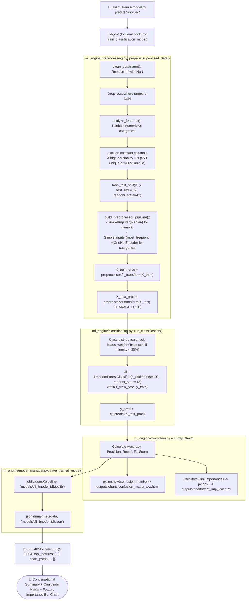
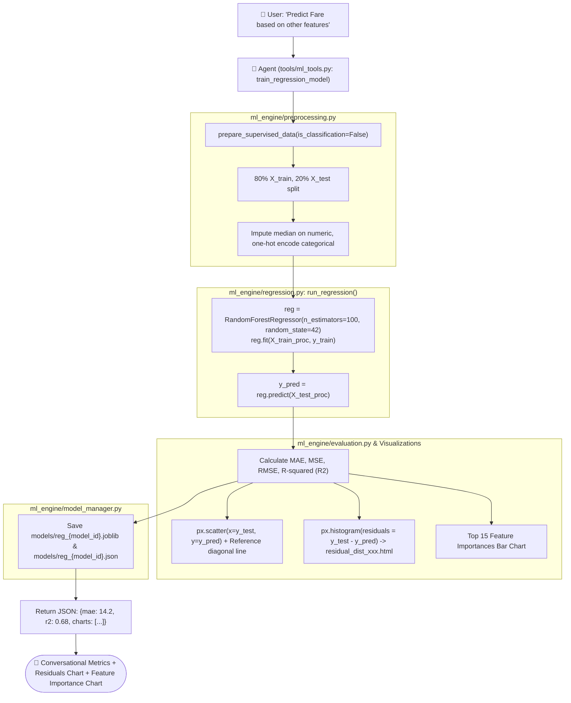
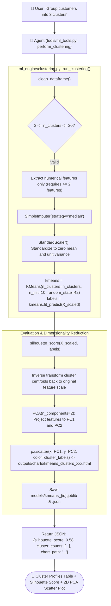

# 🔬 Machine Learning Engine Workflows

This document details the exact execution paths, data preprocessing, mathematical training, evaluation, and serialization steps for all 4 Machine Learning algorithms implemented in the repository.

---

## 1. Random Forest Classification Workflow

### Architecture (Mermaid)



### Key Technical Details
- **Leakage Prevention**: Transformations are fitted exclusively on `X_train`. `X_test` is transformed using pre-computed statistics.
- **Handling Class Imbalance**: Automatically applies `class_weight="balanced"` if the minority class represents less than 20% of training data ([classification.py#L63](file:///c:/Users/User/Desktop/AI-Data-Analyst/ml_engine/classification.py#L63)).
- **Model Serialization**: Saves both the Scikit-learn estimator and fitted preprocessor into `models/clf_{id}.joblib`.

---

## 2. Random Forest Regression Workflow

### Architecture (Mermaid)



### Key Technical Details
- **Evaluation Metrics**: `MAE`, `MSE`, `RMSE`, and $R^2$ score computed via `evaluate_regression()`.
- **Diagnostic Charts**: Generates both an **Actual vs. Predicted** scatter plot with a 45-degree reference line and a **Residuals Distribution Histogram** to verify normal error distribution.

---

## 3. Isolation Forest Anomaly Detection Workflow

### Architecture (Mermaid)

```mermaid
flowchart TD
    UserReq["👤 User: 'Detect unusual records and outliers'"]
    Agent["🧠 Agent (tools/ml_tools.py: detect_anomalies)"]

    subgraph AnomalyEngine ["ml_engine/anomaly_detection.py: run_anomaly_detection()"]
        CleanInfs["clean_dataframe(): Replace infinities with NaN"]
        ValidateContam{"Contamination between 0.001 and 0.5?"}
        SelectNumeric["Extract numeric features only (analyze_features)"]
        ImputeMedian["SimpleImputer(strategy='median') on numeric features"]
        FitIso["iso = IsolationForest(contamination=contamination, n_estimators=100, random_state=42)<br/>iso.fit(X_proc)"]
        PredictOutliers["preds = iso.predict(X_proc) (-1 = Anomaly, 1 = Normal)"]
        ScoreSamples["scores = iso.score_samples(X_proc)"]
    end

    subgraph ArtifactCreation ["Artifact Generation & Visualization"]
        FlagIndices["Identify original DataFrame row indices where pred == -1"]
        AnomalyCount["Count total anomalies & calculate percentage"]
        ScoreHist["px.histogram(scores, color=labels) -> outputs/charts/anomaly_scores_xxx.html"]
        SaveModel["Save models/iso_forest_{id}.joblib & .json"]
    end

    UserReq --> Agent
    Agent --> CleanInfs
    CleanInfs --> ValidateContam
    ValidateContam -->|Valid (e.g. 0.05)| SelectNumeric
    SelectNumeric --> ImputeMedian
    ImputeMedian --> FitIso
    FitIso --> PredictOutliers
    PredictOutliers --> ScoreSamples
    ScoreSamples --> FlagIndices
    FlagIndices --> AnomalyCount
    AnomalyCount --> ScoreHist
    ScoreHist --> SaveModel
    
    SaveModel --> RetJSON["Return JSON: {anomaly_count: 45, percentage: 5.05%, chart_path: '...'}"]
    RetJSON --> UserResult(["👤 Summary Text + Top Flagged Row Indices + Anomaly Score Histogram"])
```

### Key Technical Details
- **Contamination Bounds**: Strict validation ensures `0.001 <= contamination <= 0.5`.
- **Index Preservation**: Original row indices are preserved so users can inspect the exact anomalous records in the raw dataset.

---

## 4. K-Means Clustering Workflow

### Architecture (Mermaid)



### Key Technical Details
- **Feature Standardization**: `StandardScaler()` is mandatory to prevent high-magnitude features from dominating Euclidean distance.
- **2D PCA Projection**: When datasets have $>2$ numerical features, `sklearn.decomposition.PCA(n_components=2)` projects the feature space onto 2 principal components to render a 2D scatter plot with cluster coloring.
- **Centroid Inversion**: Cluster centers are transformed back to original physical units (`scaler.inverse_transform`) so users can interpret real-world averages for each group.
