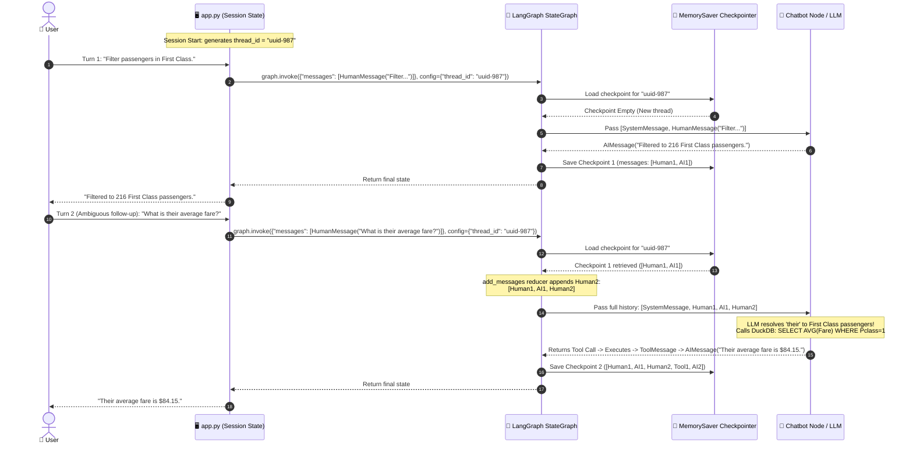

# 🧠 Conversational Memory & State Management Workflow

This document details the multi-turn conversational memory mechanism implemented using **LangGraph** and `MemorySaver`.

---

## 1. Memory Lifecycle & Checkpointing Workflow (Mermaid)



---

## 2. Technical Mechanics of `MemorySaver`

### A. Graph Definition and Reducer
In [agent.py#L78-L79](file:///c:/Users/User/Desktop/AI-Data-Analyst/agent.py#L78-L79):
```python
class State(TypedDict):
    messages: Annotated[list, add_messages]
```
- `add_messages` is LangGraph's built-in **reducer**.
- Without `add_messages`, any new node returning `{"messages": [new_msg]}` would completely overwrite previous messages.
- With `add_messages`, returning a message appends it to the list while deduplicating messages with matching UUIDs.

### B. Graph Compilation with Checkpointer
In [agent.py#L128-L129](file:///c:/Users/User/Desktop/AI-Data-Analyst/agent.py#L128-L129):
```python
memory = MemorySaver()
graph = graph_builder.compile(checkpointer=memory)
```
- `MemorySaver()` maintains an in-memory dictionary of state snapshots indexed by:
  ```python
  config = {"configurable": {"thread_id": "<uuid>"}}
  ```

---

## 3. What `MemorySaver` Stores vs. What it Does NOT Store

Understanding the boundaries of `MemorySaver` is a high-frequency interview topic:

| Entity | Stored in `MemorySaver`? | Where is it Actually Stored? |
| :--- | :---: | :--- |
| **User Messages (`HumanMessage`)** | **YES** | Checkpoint state history |
| **AI Text Responses (`AIMessage`)** | **YES** | Checkpoint state history |
| **Tool Execution Results (`ToolMessage`)** | **YES** | Checkpoint state history |
| **Tool Call IDs and Arguments** | **YES** | Inside `AIMessage.tool_calls` |
| **Raw Tabular Dataset (`DataFrame`)** | ❌ **NO** | Kept in RAM inside `data_store.df` |
| **Plotly Chart Objects / HTML** | ❌ **NO** | Saved to local filesystem (`outputs/charts/`) |
| **Trained ML Models (.joblib)** | ❌ **NO** | Saved to local filesystem (`models/`) |
| **Streamlit UI State** | ❌ **NO** | Managed in browser session via `st.session_state` |

> **Architectural Defense**:
> *"We intentionally keep large objects (DataFrames, Plotly HTML bundles, Joblib binaries) **out** of the LangGraph state. Injecting a 500 MB DataFrame into the state would force the checkpointer to serialize hundreds of megabytes on every graph step and quickly exceed the LLM's context window. Instead, the state only stores lightweight semantic messages and file path references."*
